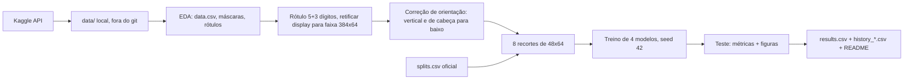
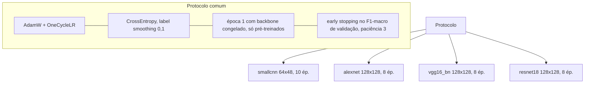
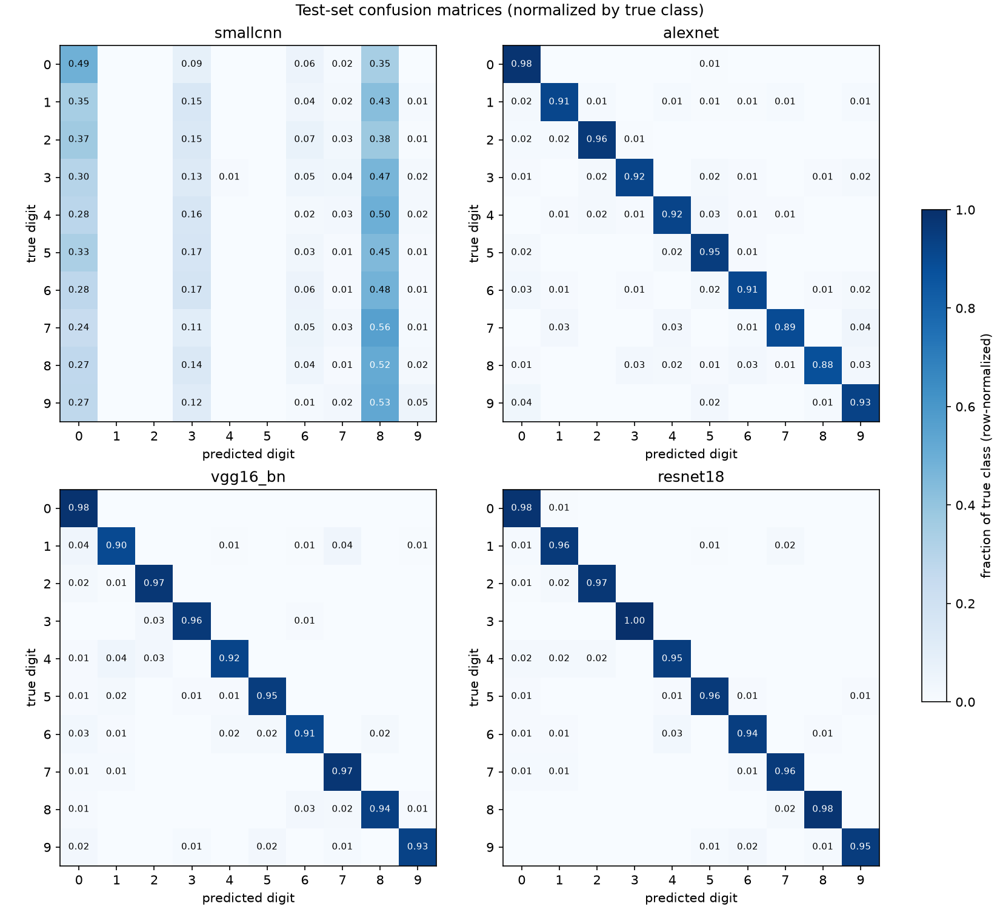
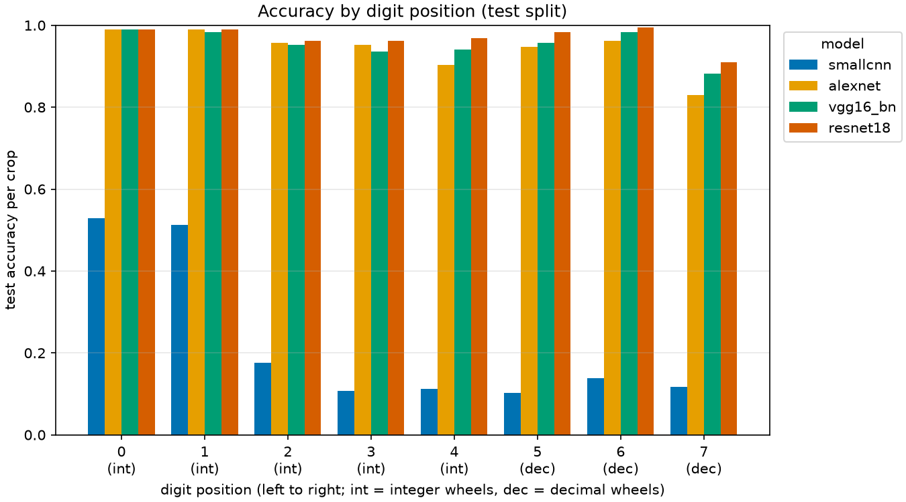
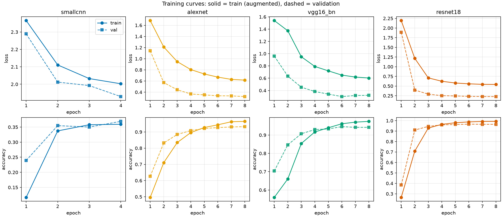
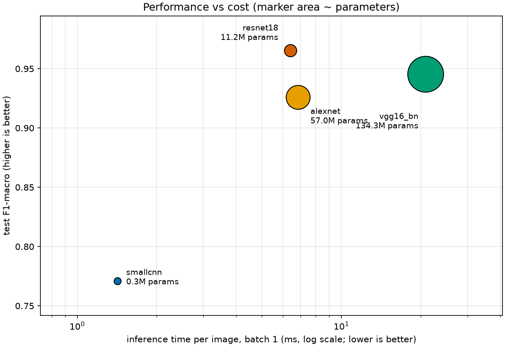

# Luminus (Grupo 2) — Classificação de Dígitos de Hidrômetros com AlexNet, VGG16 e ResNet

**Disciplina:** Visão Computacional (VC001) — CESAR School, 2026.2
**Integrantes:** Angelita Dias de Santana (ads2@cesar.school) · Carolline de Araújo Mariz (cam3@cesar.school) · Fernando Cyreno Rangel da Silva (fcrs@cesar.school) · Guaraci de Barros Rios (gbr2@cesar.school) · Ivo Caetano Andrade Júnior (icaj@cesar.school) · Mikael de Albuquerque Mulatinho (mam2@cesar.school) · João Rietra (jhlr@cesar.school)

## Fonte dos dados e licença

Dataset: [Yandex.Toloka Water Meters](https://www.kaggle.com/datasets/tapakah68/yandextoloka-water-meters-dataset),
licença **CC BY-NC-ND 4.0**. Este repositório **não** contém imagens do dataset, recortes gerados nem checkpoints.
O uso é restrito a fins acadêmicos e não comerciais. As figuras deste README são gráficos gerados a partir de métricas; os esquemas de recorte usam desenhos sintéticos, nunca fotos do dataset.

## Resumo

Construímos um dataset de dígitos (10 classes) a partir das leituras dos hidrômetros (5 dígitos inteiros + 3 decimais), treinamos `smallcnn`, AlexNet, VGG16-BN e ResNet18 sob um único protocolo no `splits.csv` oficial e avaliamos só no conjunto de teste (187 imagens, 1496 recortes). No teste, a ResNet18 foi a melhor (acc por dígito e F1-macro mais altos na tabela abaixo), mas a acurácia de leitura completa (8 dígitos certos) fica bem abaixo da acurácia por dígito. A `smallcnn` do código-base, como veio, **não aprendeu** (acurácia 0,2246); a causa era o *global average pooling* da cabeça, que descarta a posição dos traços. Com a cabeça corrigida (resposta 5.6) ela chega a F1-macro 0,7711, ainda bem abaixo dos pré-treinados. O desafio extra (divisão de dígitos pelas fronteiras reais) está em seção própria e em arquivo separado (`results_extra.csv`).

## Pipeline



Divisão de uma faixa em 8 recortes (esquema sintético, não é foto do dataset). A grade de largura igual assume 8 células de 48 px; em displays com 5 rodas, 5 células largas (76,8 px cada) viram 8 fatias de 48 px:

```text
display real, 5 rodas:   |  0   |  0   |  1   |  2   |  8   |      (cada roda ~76,8 px)
grade igual (8 x 48 px): | 0 | 0 | 0 | 0 | 1 | 2 | 8 | 8 |       (fatias que cortam dígitos ao meio)
rótulo (5+3):              0   0   0   1   2   8   0   0
                                                   ^   ^   ^ zeros decimais que não existem no display
```



## Como reproduzir

```bash
git clone https://github.com/jhlr/hidrometros && cd hidrometros
python3 -m venv .venv && source .venv/bin/activate
pip install -e ".[dev]"            # instala a biblioteca `hidrometros` e as dependências (requirements.txt)
# colocar o kaggle.json em ~/.kaggle/ (chmod 600); nunca versionar
kaggle datasets download -d tapakah68/yandextoloka-water-meters-dataset -p data --unzip   # gera data/WaterMeters/
hidrometros integrity              # confere contagens, imagens abrem, sha256 do splits.csv
hidrometros prep                   # retifica, corrige orientação, gera digits/ e digits/index.csv (~minutos, CPU)
hidrometros smoke                  # opcional: 2 épocas por modelo em 256 treino / 128 val
caffeinate -i hidrometros train all --resume      # ordem: smallcnn, resnet18, alexnet, vgg16_bn (retoma de last.pt)
hidrometros evaluate               # results.csv + reports/ (somente teste)
hidrometros figures                # as 4 figuras
hidrometros prep-extra && caffeinate -i hidrometros train all --variant extra --resume && hidrometros evaluate --variant extra   # desafio extra
hidrometros readme                 # regenera as tabelas deste README a partir de results.csv
make check                         # critérios de aceitação 1 a 13
```

- Ambiente usado: local, Apple M1 (MPS), Python 3.14, PyTorch/torchvision das versões de `requirements.txt` resolvidas no momento da execução. A MPS não é determinística bit a bit: fixamos `seed=42` (python, numpy, torch, DataLoader), mas **não** afirmamos reprodutibilidade exata; não medimos o ruído entre execuções repetidas.
- Tempo total de execução: o treino soma cerca de 72 min (soma da coluna `seconds` dos `history_*.csv`: smallcnn 1,5 min, alexnet 4,8 min, resnet18 7,4 min, vgg16_bn 58,8 min), sem contar validação, carga de dados e a preparação das faixas. O desafio extra repete o treino.
- Split utilizado: `splits.csv` **oficial** fornecido pelo professor (não alterado; sha256 `ca4c5d8ad131d63eae3a8acd5bd6ac1091f55e02426d8ad083af98cfa65abf2b`, conferido por teste).

## Protocolo de treino

<!-- protocol:start -->
| Modelo | Pesos | Entrada | Batch (usado: MPS) | LR cabeça | LR backbone | Épocas máx. | Melhor época |
|---|---|---|---|---|---|---|---|
| smallcnn | do zero | 64×48 | 128 | 0.001 | — | 10 | 10 |
| alexnet | ImageNet (IMAGENET1K_V1) | 128×128 | 64 | 0.001 | 0.0001 | 8 | 8 |
| vgg16_bn | ImageNet (IMAGENET1K_V1) | 128×128 | 16 | 0.001 | 1e-05 | 8 | 6 |
| resnet18 | ImageNet (IMAGENET1K_V1) | 128×128 | 64 | 0.001 | 0.0001 | 8 | 6 |
<!-- protocol:end -->

Comum aos quatro: `AdamW` + `OneCycleLR` (agenda construída para `max_epochs × passos`, o early stopping apenas a corta); `CrossEntropyLoss(label_smoothing=0.1)`; época 1 com o backbone congelado (só pré-treinados); early stopping no F1-macro de validação com paciência 3; `seed=42`; aumento `RandomAffine(5°, translate 5%, scale 0,95–1,05)` + `ColorJitter(brilho 0,3, contraste 0,3)`, **sem flip**; normalização com média/desvio da ImageNet em todos os modelos (inclusive `smallcnn`). Melhor checkpoint por F1-macro de validação.

Alterações em relação ao protocolo oficial (e justificativa): nenhuma no protocolo em si. Detalhes de implementação e desvios do plano de execução estão em [`docs/2026-10-13-spec-deviations.md`](docs/2026-10-13-spec-deviations.md); os que afetam números: (1) na época 1 congelada, as camadas BatchNorm do backbone ficam em modo `eval` (estatísticas não são atualizadas); (2) no VGG16, o `AdaptiveAvgPool2d` roda na CPU quando o modelo está na MPS (a MPS não suporta essa redução não divisível; o resultado numérico é o da camada original, mas o `ms_per_image` do VGG16 inclui essa ida e volta); (3) o classificador de orientação das faixas é um conjunto de 5 sementes treinado em CPU; (4) **a arquitetura da `smallcnn` foi alterada** (só ela, o protocolo não; é uma correção de arquitetura do modelo de referência, não uma mudança de protocolo, e o resultado do código-base original, acurácia 0,2246, F1-macro 0,0904 e leitura 0,0000, fica registrado em 5.6 e no Resumo): o `AdaptiveAvgPool2d((1,1))` do código-base foi trocado por `Flatten` seguido de `Linear(128·16·12, 10)`, porque o pooling global impedia o aprendizado (causa e experimentos em [`docs/2026-10-14-smallcnn-root-cause.md`](docs/2026-10-14-smallcnn-root-cause.md)). Entrada 64×48, três convoluções, 10 épocas, mesmo otimizador, LR, perda, seed, divisão e early stopping; as outras três linhas de `results.csv` não mudam porque o código compartilhado de treino não foi alterado.

## Resultados (conjunto de teste)

Tabela gerada por script a partir de `results.csv` (`hidrometros readme`); nada digitado à mão. `s_per_epoch` = mediana do tempo do laço de treino por época (sem validação), `ms_per_image` = batch 1, mesma máquina/dispositivo (MPS) para os quatro, 20 execuções de aquecimento e 200 medidas, sem custo de transformação.

<!-- results:start -->
| model | acc_digit | f1_macro | acc_reading | params_M | s_per_epoch | ms_per_image | ckpt_MB | best_epoch |
|---|---|---|---|---|---|---|---|---|
| smallcnn | 0.8155 | 0.7711 | 0.3102 | 0.34 | 7.0 | 1.42 | 1.4 | 10 |
| alexnet | 0.9412 | 0.9261 | 0.6952 | 57.04 | 35.0 | 6.86 | 228.2 | 8 |
| vgg16_bn | 0.9532 | 0.9455 | 0.7701 | 134.31 | 473.6 | 20.80 | 537.3 | 6 |
| resnet18 | 0.9699 | 0.9654 | 0.8556 | 11.18 | 57.4 | 6.42 | 44.8 | 6 |
<!-- results:end -->

Figuras (pasta `figures/`):

- Matrizes de confusão normalizadas: `figures/confusion_matrices.png`
- Acurácia por posição: `figures/accuracy_by_position.png`
- Curvas de treino: `figures/training_curves.png`
- Desempenho × custo: `figures/performance_vs_cost.png`






## Desafio extra: divisão de dígitos pelas fronteiras

**Resultado: o desafio extra não melhorou nada; os quatro modelos ficaram pior com a nova divisão (resultado negativo).** A divisão extra (`src/hidrometros/splitting.py`) procura a grade de 8 células (deslocamento e passo) cujas fronteiras caem nos pontos de menor variação vertical de intensidade por coluna e refina cada fronteira localmente; cada célula é reamostrada para 48x64, então modelos e protocolo são idênticos (mesmo `splits.csv`, seed 42, mesmas épocas máximas, mesmos batches). Os resultados ficam em `results_extra.csv` (nunca misturados a `results.csv`); a tabela abaixo é gerada por script e mostra a diferença para a linha de base (extra menos base).

Indicador de recorte cortado (aproximação, não verdade de campo: tinta encostando na borda do recorte, calculada na própria projeção que a divisão otimiza, portanto otimista a favor dela): bordas esquerda/direita com tinta em 5450/5289 recortes (de 9944) com a grade igual contra 4105/4267 com a divisão extra; imagens com pelo menos um recorte assim: 1147 contra 1095 (de 1243). Ou seja, o indicador melhorou e a acurácia piorou: o indicador não mede o que o modelo precisa. Causas possíveis, **não** testadas: as fronteiras estimadas erram em faixas de contraste baixo; a reamostragem de células de largura variável muda a escala do dígito de recorte para recorte; e o modelo da linha de base pode ter aprendido a lidar com a grade fixa (posição constante do dígito na célula). O README não afirma nenhuma delas. A `smallcnn` (já com a cabeça corrigida, retreinada nesta divisão) também piorou: -0,0628 em acc_digit e -0,1284 em acc_reading.

Também não resolve os displays de 5 rodas (o rótulo continua com 3 zeros que não existem no display) nem a roda rolando.

<!-- extra:start -->
| model | acc_digit | f1_macro | acc_reading | best_epoch | Δ acc_digit | Δ f1_macro | Δ acc_reading |
|---|---|---|---|---|---|---|---|
| smallcnn | 0.7527 | 0.6988 | 0.1818 | 10 | -0.0628 | -0.0723 | -0.1284 |
| alexnet | 0.9218 | 0.9040 | 0.6417 | 7 | -0.0194 | -0.0221 | -0.0535 |
| vgg16_bn | 0.9425 | 0.9346 | 0.7594 | 7 | -0.0107 | -0.0109 | -0.0107 |
| resnet18 | 0.9566 | 0.9505 | 0.8128 | 6 | -0.0133 | -0.0149 | -0.0428 |
<!-- extra:end -->

## Respostas às questões

As respostas abaixo partiram do texto escrito pelo Mikael (integrante do grupo). A IA conferiu cada número contra `results.csv` e os logs, corrigiu o que estava errado ou incompleto e ajustou a redação (registro em `docs/2026-10-14-respostas-mikael-revisadas.md`).

**1.1** *O que contém cada pasta e cada coluna do `data.csv`? Quais pastas servem para treinar um modelo?* O `data.csv` manda em tudo: tem uma linha por foto, com `photo_name` (nome do arquivo, por exemplo `id_53_value_595_825.jpg`), `value` (a leitura do hidrômetro, número decimal) e `location` (o polígono do mostrador, em texto, com x e y de 0 a 1). As pastas são três: `images/` (as 1244 fotos completas), `masks/` (máscaras em tons de cinza da região do mostrador, 1244) e `collage/` (a foto com a máscara por cima, só pra visualizar). Pra treinar, usamos só `images/` e o polígono do `location`. As máscaras serviram só como tira-teima do recorte (IoU mediana de 0,983), e as colagens ficaram fora do treino.

**1.2** *O rótulo disponível é por imagem ou por dígito? O que isso implica para a tarefa?* O rótulo é da foto inteira, não de cada número, então a gente tem que fatiar o mostrador em 8 e dar a cada fatia o dígito da posição dela. O perigo disso? Se o recorte sair torto ou cair no meio de duas rodas, o modelo vai tentar aprender um número que não está naquela fatia, sujando o treino com lixo.

**2.1** *Qual é a fonte mais confiável para o rótulo de cada imagem? Justifique com evidências.* A fonte mais confiável é a coluna `value` do CSV. Padronizamos tudo para 5 dígitos inteiros e 3 decimais, completando com zeros (à esquerda nos inteiros e à direita nos decimais, porque o `value` perde os zeros do final: 21,86 é 21,860). Isso funciona porque bate com os nomes dos arquivos (1244 de 1244) e com a inspeção visual que fizemos. Só que o nome do arquivo sozinho não prova nada, porque vem da mesma anotação; a checagem de verdade foi visual, olhando cerca de 165 faixas retificadas na auditoria de orientação.

**2.2** *Qual dígito deve ser a classe majoritária? Por quê?* O dígito "0" domina geral, com 35,7% da base, porque a gente encheu a parte inteira de zeros à esquerda. No teste ele é 34,4% dos recortes, então um modelo inútil que chutasse "0" pra tudo já garantiria uns 34% de acerto. Essa é a nossa nota de corte.

**3.1** *Por que a divisão é feita por imagem e não por recorte? Por que todos os grupos usam o mesmo `splits.csv`?* A divisão de treino e teste tem que ser feita pela foto original, nunca pelo recorte. Se fatiar antes, pedaços do mesmo hidrômetro vazam pro treino e pro teste, fazendo a rede "decorar" o fundo da foto em vez de aprender a ler o número. Todos os grupos usam o mesmo `splits.csv` pra que os resultados sejam comparáveis e ninguém ajuste a divisão a favor do próprio modelo.

**3.2** *Quantas faixas foram corrigidas? Identifique e quantifique os tipos de recorte errado que o pipeline produz.* A gente endireitou 136 fotos tortas (84 verticais e 52 inclinadas) e desvirou 56 de cabeça para baixo (36 pela regra do vermelho e 20 pelo classificador de orientação). Só que o recorte automático continuou falhando de três jeitos: (a) fatiou errado os mostradores de 5 rodas, em que o rótulo tem 3 zeros decimais que não existem na imagem (36 imagens têm decimais `000`, e em 22 de 24 que olhamos o mostrador tem só 5 rodas); (b) cortou as bordas dos números: com a grade igual, 5450 dos 9944 recortes têm tinta na borda esquerda, 5289 na direita e 4238 nas duas (indicador aproximado); (c) se perdeu em rodas girando no meio da transição, que é a nossa hipótese pros erros concentrados na última casa (no teste, a posição 7 tem 17 dos 45 erros da ResNet18; não classificamos os erros um a um).

**3.3** *Que erro a divisão da faixa em larguras iguais introduz? Como você o corrigiria?* A grade de fatias iguais assume 8 células de 48 px, uma por dígito. O erro é que a fronteira real entre as rodas quase nunca cai a cada 48 px: a fatia pega um pedaço de um dígito e um pedaço do vizinho, ou corta um dígito ao meio (medimos que 5450 dos 9944 recortes têm tinta encostando na borda esquerda e 5289 na direita). Piora se o mostrador tiver 5 rodas (5 células largas viram 8 fatias) ou se a foto sair desalinhada. A correção que testamos no desafio extra foi achar a divisão de cada roda pela variação de intensidade das colunas de pixels, em vez da grade fixa, mas não funcionou: a acurácia por dígito caiu nos quatro modelos (por exemplo, 0,0133 na ResNet18). E nos mostradores de 5 rodas o recorte não resolve, porque o rótulo continua com 3 zeros que não existem; aí teria que detectar o número de rodas e ajustar o rótulo.

**4.1** *Por que normalizar as imagens com a média e o desvio padrão do ImageNet?* Normalizamos as cores com o padrão da ImageNet pra os modelos pré-treinados não estranharem as fotos, já que foram treinados com entradas nessa escala. Aplicamos isso também na nossa rede menor (smallcnn) só pra manter a regra do jogo igual pra todo mundo, não porque ela dependesse disso.

**4.2** *Compare o número de parâmetros dos quatro modelos. Onde se concentram os parâmetros da AlexNet e da VGG16?* A diferença de tamanho é grande: a smallcnn tem 0,34 M de parâmetros, a ResNet18 11,18 M, a AlexNet 57,04 M e a VGG16 134,31 M. Na AlexNet, 95,7% dos parâmetros estão nas camadas densas do final (`classifier`), e na VGG16 são 89,0%. A ResNet18 evita isso usando uma média global: a cabeça dela tem só 5130 parâmetros, e o peso está nas convoluções.

**4.3** *Qual a diferença entre treinar só a cabeça e fazer fine-tuning completo? Por que congelar o backbone apenas na primeira época?* Treinar só a cabeça é ajustar apenas a última camada, com o resto da rede congelado; o fine-tuning completo ajusta a rede inteira. Na primeira época a gente "congela" o corpo da rede porque a cabeça nova começa aleatória: se treinássemos tudo desde o começo, os gradientes grandes e sem sentido dessa cabeça iam bagunçar os filtros bons que vieram da ImageNet. Depois que a cabeça já aprendeu algo útil, destrava tudo e treina o modelo inteiro devagar (taxa 1e-4 no corpo, ou 1e-5 na VGG16), pra adaptar os filtros a dígitos de hidrômetro.

**4.4** *Por que não usar flip neste problema?* Espelhar a imagem (flip) aqui é tiro no pé, porque um 2, um 3 ou um 5 espelhado não existe num hidrômetro, e a rede aprenderia formas que nunca aparecem. O aumento de dados foi só girar um pouco (até 5°), mexer um pouco de posição e escala e mudar brilho e contraste, pra simular os defeitos de uma câmera de celular.

**5.1** *Qual modelo teve o melhor F1-macro? O ranking é o mesmo da acurácia? Por quê?* A ResNet18 teve o melhor F1-macro (0,9654) e a maior acurácia por dígito (0,9699), seguida de VGG16 (0,9455 e 0,9532), AlexNet (0,9261 e 0,9412) e smallcnn (0,7711 e 0,8155). O ranking é o mesmo nas duas métricas, e nenhum dos três pré-treinados sacrifica uma classe pra inflar a nota nas fáceis. O F1-macro e a acurácia só se afastariam se o modelo ficasse bom nas classes fáceis e ruim nas raras: como o 0 é mais de um terço dos recortes (34,4% no teste), a acurácia é puxada por ele, e o F1-macro dá o mesmo peso a cada dígito. Nos três pré-treinados isso não aconteceu (as duas métricas ficam a menos de 0,02 uma da outra); na smallcnn a distância é maior (0,8155 contra 0,7711), por causa da classe majoritária. A diferença entre AlexNet e VGG16 é pequena e vem de uma execução só, então a ordem entre elas pede cautela.

**5.2** *Quais pares de classes mais se confundem? Por quê?* A ResNet18 quase não erra e tropeça em poucos pares: (0→1) 4 vezes, (1→7) 3, (2→1) 3 e (6→4) 3, traços parecidos (1 e 7) ou o 1 e o 0, que são os dígitos mais frequentes. Parte pode ser engrenagem rodando, mas não classificamos os erros um a um. A VGG16 erra mais (1→7) e (1→0), 6 vezes cada. A smallcnn erra mais e puxa pra classe mais frequente: prevê "0" em 36,8% dos recortes de teste (os zeros são 34,4%), e os pares que mais erra são (6→0), 13 vezes, e (1→0), 12.

**5.3** *Por que `acc_reading` é muito menor que `acc_digit`?* Acertar a leitura inteira é muito mais difícil que acertar um dígito solto. Como a leitura tem 8 números, errar um só já invalida a foto toda: se os erros fossem independentes, a leitura inteira acertaria cerca de p^8, que pra ResNet18 (p = 0,9699) dá uns 0,78. O observado é 0,8556, um pouco melhor, porque os erros se concentram em poucas imagens (27 das 187 de teste têm algum erro) e na última casa. É por isso que a ResNet tem 97% de acerto por dígito, mas cai pra 85,6% na leitura completa. Na smallcnn é pior: 81,6% por dígito vira 31,0% por leitura.

**5.4** *Qual modelo você colocaria em um aplicativo de celular? Justifique com números.* Pra rodar num celular, a ResNet18 é a melhor opção: acerta 0,9699 por dígito e 0,8556 a leitura inteira, pesa só 44,8 MB e leva 6,42 ms por imagem. A AlexNet fica no meio (0,9412 por dígito, 228,2 MB, 6,86 ms): é tão rápida quanto a ResNet18, mas acerta menos e pesa umas 5 vezes mais, então a ResNet18 ganha dela também. A VGG16 tem 537,3 MB e 20,80 ms, pesada demais pro aparelho. A smallcnn é leve (1,4 MB), mas erra uns 69% das leituras completas, o que seria inútil pro negócio. Esses tempos foram medidos no nosso Mac (MPS), não num celular, então valem pra comparar os modelos entre si.

**5.5** *O que a ResNet traz em relação à VGG16 neste problema?* A ResNet18 ganhou da VGG16 em tudo: acurácia por dígito 0,9699 contra 0,9532, e leitura completa 0,8556 contra 0,7701. E ainda gasta 12 vezes menos memória (44,8 MB contra 537,3 MB), faz a inferência 3,2 vezes mais rápida (6,42 ms contra 20,80 ms) e treina uns 8 vezes mais rápido por época. Ela usa conexões residuais e não tem as camadas densas gigantes da VGG16.

**5.6** *A `smallcnn` foi competitiva com as redes pré-treinadas? O que isso indica?* A smallcnn tinha um bug de arquitetura: o pooling global da cabeça esmagava os pixels e deixava a rede cega sobre onde estavam os traços do número (acurácia 0,2246). Corrigimos trocando por um Flatten e ela voltou a aprender (0,8155), mas ficou uns 15 pontos abaixo da ResNet18 e ainda melhorava na época 10, então 10 épocas limitam ela. Isso sugere que transferir inteligência pré-treinada ajuda bastante, mas a comparação mistura duas coisas (o pré-treino e a cabeça diferente) e é de uma execução só, então não dá pra separar quanto vem de cada uma.

## Limitações

- **Ruído de rótulo por posição:** o rótulo de cada recorte vem da posição na leitura de 8 dígitos, sem anotação por dígito. Displays de 5 rodas (36 imagens válidas com decimais `000`, 22 de 24 amostradas com 5 rodas) geram zeros fantasma; rodas rolando e recortes que cortam dígitos geram rótulos que o recorte não mostra de fato.
- **O que o pipeline faz de errado:** a última casa decimal concentra os erros (por exemplo 17 dos 45 erros da ResNet18). A auditoria de orientação foi exaustiva só nas faixas viradas e em amostras das não viradas (cerca de 165 de 1243 vistas); uma virada perdida entre as outras não está excluída (limite superior de 95% de cerca de 6% a partir de 50 amostras sem erro).
- **Dados contra modelo:** não separamos formalmente quanto do erro restante é dos dados e quanto é do modelo. Indícios: os erros se concentram na última casa (rolagem) e em poucas imagens (27 de 187 na ResNet18), o que aponta para dados/recorte; no entanto, as diferenças entre modelos nas mesmas posições mostram que o modelo também importa. Uma comparação com um rotulador humano nos recortes de teste dependeria de anotação manual, que não fizemos.
- **Uma execução por modelo, `seed=42`:** sem intervalos de confiança e sem medir o ruído entre execuções (a MPS não é bit a bit determinística). As diferenças pequenas entre AlexNet, VGG16-BN e ResNet18 devem ser lidas com cautela.
- **`smallcnn`:** o resultado inicial (0,2246) era um defeito de arquitetura corrigido e documentado (ver 5.6); a versão corrigida usa 0,34 M parâmetros e ainda melhora na época 10, então não sabemos o teto dela com mais épocas (o protocolo fixa 10). Escolhemos a cabeça por F1 de validação entre 4 variantes, uma execução cada, sem sementes repetidas.
- **Latência medida na MPS de um M1**, não em celular; a do VGG16 inclui uma passagem do pooling pela CPU.
- **O que mudaríamos:** detectar o número de rodas do display e ajustar o rótulo; anotar por dígito uma amostra de teste; tentar uma `smallcnn` mais profunda, e repetir com mais sementes.

## Declaração de uso de IA

**Este trabalho foi feito com Desenvolvimento Guiado por Especificação (Spec-Driven Development, SDD).** A especificação (`docs/SPEC.md`, v1.3, de 2026-10-13) foi escrita e aprovada antes do código e está commitada no repositório: [`docs/SPEC.md`](docs/SPEC.md). A IA (Claude, da Anthropic, via Claude Code) executou a especificação; as decisões de escopo (D1 a D7 abaixo) foram do integrante João Rietra, que conduziu a sessão.

**Procedência do código inicial.** O esqueleto inicial (`SmallCNN`, `build_model`, funções de congelar/descongelar, divisão em 8 recortes, métricas e `set_seed`) foi escrito por **Mikael de Albuquerque Mulatinho** (integrante do grupo, humano) e está no histórico do git com a autoria dele (commit `152bc8b`: ele escreveu o código fora do repositório e o commit foi feito por jhlr, mantendo o nome do Mikael como autor). Foi depois estendido e corrigido sob a especificação; não é produto da IA. O Mikael informou ao grupo que não usou ferramenta de IA nesse esqueleto.

**O que a IA fez e o que o grupo decidiu ou verificou:**

| Fase | O que a IA fez | O que o grupo decidiu / verificou |
|---|---|---|
| F0 esqueleto | Criou o repositório, venv, `.gitignore`, salvou a especificação | Aprovou a especificação (SDD) e o escopo |
| F1 dados | Baixou o dataset pela API do Kaggle, conferiu contagens, imagens e o sha256 do `splits.csv` | Forneceu as credenciais do Kaggle e autorizou o download |
| F2 EDA | Estrutura de `data.csv`, fonte do rótulo, prior dos dígitos | Revisão dos achados (Q 1.1 a 2.2) |
| F3 preparação | Retificação, regra do vermelho, classificador de orientação, auditoria, recortes | Conferiu o portão 1: todas as faixas das folhas de auditoria estavam em pé |
| F4 treino | Treinou os 4 modelos sob o mesmo protocolo na MPS | D1: treino local com batches de MPS/CPU |
| F4b correção da smallcnn | Isolou a causa raiz (cabeça com *global average pooling*), corrigiu a cabeça, retreinou só a `smallcnn`, escreveu o teste-guarda (visto vermelho antes) | Aceitou a mudança de arquitetura da `smallcnn` como alteração documentada |
| F5 avaliação | `results.csv`, relatórios, 4 figuras | Revisão dos resultados |
| F6 extra | Divisão de dígitos pelas fronteiras, retreino com o mesmo protocolo | D5: desafio extra decidido, arquivo separado |
| F7 documentação | Rascunho do README e da seção Limitações; conferiu e ajustou as respostas do Mikael contra `results.csv` | D4: as respostas partem do texto do Mikael; o grupo revisa as limitações |

**Decisões humanas travadas:** D1 treino local na MPS com batches de MPS/CPU · D2 biblioteca em `src/` e notebook fino · D3 nenhuma foto do dataset no git · D4 respostas escritas pelo Mikael e conferidas pela IA · D5 desafio extra = melhor divisão de dígitos, em arquivo separado · D6 repositório público, sem colaboradores · D7 integrantes a partir de `nome-emails.txt`.

**Rastreabilidade (critério, teste, commit).** O `make check` imprime uma linha PASS/FAIL por critério; os testes ficam em `tests/test_guards.py`.

| Critério | Teste / verificação | Commit que o introduziu |
|---|---|---|
| 1 sha256 do `splits.csv` | `test_c01_*` | `9ff36ba` |
| 2 1243 / 1 / 9944, 6 colunas | `test_c02_*` | `9ff36ba` |
| 3 sem vazamento entre splits | `test_c03_*` | `9ff36ba` |
| 4 contagens de faixas na resposta 3.2 | `make check` (c04) | README final |
| 5 protocolo, seed 42, sem flip | `test_c05_*` | `9ff36ba`, `44bebca` |
| 6, 7, 9 histórico, resultados (só teste), relatórios | `test_c07_*`, `make check` | `446b42b` |
| 8 figuras e embutidas no README | `make check` (c08) | `446b42b`, README final |
| 10 notebook sem imagens | `test_c10_*` | `9ff36ba`, `446b42b` |
| 11 README == `results.csv` | `test_c11_*` | README final |
| 12 git sem imagens/crops/checkpoints/credenciais | `test_c12_*` | `9ff36ba`, `446b42b` |
| 13 repositório público | `make check` (c13) | repositório tornado público em 2026-10-14 |
| 14 guardas vistas em vermelho | `docs/2026-10-13-guard-red.md` | README final |

**Respostas e limitações:** as 17 respostas partiram do texto do Mikael; a IA conferiu números e fatos, corrigiu erros (por exemplo, o resultado do desafio extra e a `smallcnn` já corrigida) e ajustou a redação mantendo o tom dele. A seção Limitações foi rascunhada pela IA a partir de `results.csv` e dos logs, e o grupo a revisa.

**Formulário da disciplina (seções A, B e C do template).** Preenchido em [`docs/ia/DECLARACAO_USO_IA.md`](docs/ia/DECLARACAO_USO_IA.md) e, no formato original do template, em [`docs/ia/Declaracao_Uso_IA_Luminus_Grupo2.docx`](docs/ia/Declaracao_Uso_IA_Luminus_Grupo2.docx). Resumo: **Seção A** (LLM): Claude Sonnet 5.5 pelo Claude Code; o prompt é o SDD completo, [`docs/SPEC.md`](docs/SPEC.md). **Seção B** (skills): `spec` (gstack) e `minions`, com SHA-256 e datas no formulário; os arquivos `SKILL.md` seguem à parte da entrega. **Seção C** (SDD): `docs/SPEC.md`, redigido pela IA com decisões de escopo humanas.
