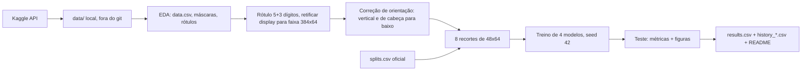
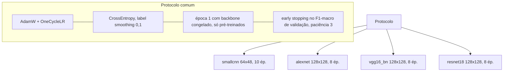

# Luminus (Grupo 2) — Classificação de Dígitos de Hidrômetros com AlexNet, VGG16 e ResNet

**Disciplina:** Visão Computacional (VC001) — CESAR School, 2026.2
**Integrantes:** Angelita Dias de Santana (ads2@cesar.school) · Carolline de Araújo Mariz (cam3@cesar.school) · Fernando Cyreno Rangel da Silva (fcrs@cesar.school) · Guaraci de Barros Rios (gbr2@cesar.school) · Ivo Caetano Andrade Júnior (icaj@cesar.school) · Mikael de Albuquerque Mulatinho (mam2@cesar.school) · João Rietra (jhlr@cesar.school)

## Fonte dos dados e licença

Dataset: [Yandex.Toloka Water Meters](https://www.kaggle.com/datasets/tapakah68/yandextoloka-water-meters-dataset),
licença **CC BY-NC-ND 4.0**. Este repositório **não** contém imagens do dataset, recortes gerados nem checkpoints.
O uso é restrito a fins acadêmicos e não comerciais. As figuras deste README são gráficos gerados a partir de métricas; os esquemas de recorte usam desenhos sintéticos, nunca fotos do dataset.

## Resumo

Construímos um dataset de dígitos (10 classes) a partir das leituras dos hidrômetros (5 dígitos inteiros + 3 decimais), treinamos `smallcnn`, AlexNet, VGG16-BN e ResNet18 sob um único protocolo no `splits.csv` oficial e avaliamos só no conjunto de teste (187 imagens, 1496 recortes). No teste, a ResNet18 foi a melhor (acc por dígito e F1-macro mais altos na tabela abaixo), mas a acurácia de leitura completa (8 dígitos certos) fica bem abaixo da acurácia por dígito. A `smallcnn` do código-base, como veio, **não aprendeu** (acurácia 0,2246); a causa era o *global average pooling* da cabeça, que descarta a posição dos traços. Com a cabeça corrigida (resposta 5.6) ela chega a F1-macro 0,7711, ainda bem abaixo dos pré-treinados. O desafio extra (divisão de dígitos pelas fronteiras reais) está em seção própria e em arquivo separado (`results_extra.csv`).

## Pipeline



Divisão de uma faixa em 8 recortes (esquema sintético, não é foto do dataset). A grade de largura igual assume 8 células de 48 px; em displays com 5 rodas, 5 células largas (76,8 px cada) viram 8 fatias de 48 px:

```text
display real, 5 rodas:   |  0   |  0   |  1   |  2   |  8   |      (cada roda ~76,8 px)
grade igual (8 x 48 px): | 0 | 0 | 0 | 0 | 1 | 2 | 8 | 8 |       (fatias que cortam dígitos ao meio)
rótulo (5+3):              0   0   0   1   2   8   0   0
                                                   ^   ^   ^ zeros decimais que não existem no display
```



## Como reproduzir

```bash
git clone https://github.com/jhlr/hidrometros && cd hidrometros
python3 -m venv .venv && source .venv/bin/activate
pip install -e ".[dev]"            # instala a biblioteca `hidrometros` e as dependências (requirements.txt)
# colocar o kaggle.json em ~/.kaggle/ (chmod 600); nunca versionar
kaggle datasets download -d tapakah68/yandextoloka-water-meters-dataset -p data --unzip   # gera data/WaterMeters/
hidrometros integrity              # confere contagens, imagens abrem, sha256 do splits.csv
hidrometros prep                   # retifica, corrige orientação, gera digits/ e digits/index.csv (~minutos, CPU)
hidrometros smoke                  # opcional: 2 épocas por modelo em 256 treino / 128 val
caffeinate -i hidrometros train all --resume      # ordem: smallcnn, resnet18, alexnet, vgg16_bn (retoma de last.pt)
hidrometros evaluate               # results.csv + reports/ (somente teste)
hidrometros figures                # as 4 figuras
hidrometros prep-extra && caffeinate -i hidrometros train all --variant extra --resume && hidrometros evaluate --variant extra   # desafio extra
hidrometros readme                 # regenera as tabelas deste README a partir de results.csv
make check                         # critérios de aceitação 1 a 13
```

- Ambiente usado: local, Apple M1 (MPS), Python 3.14, PyTorch/torchvision das versões de `requirements.txt` resolvidas no momento da execução. A MPS não é determinística bit a bit: fixamos `seed=42` (python, numpy, torch, DataLoader), mas **não** afirmamos reprodutibilidade exata; não medimos o ruído entre execuções repetidas.
- Tempo total de execução: o treino soma cerca de 72 min (soma da coluna `seconds` dos `history_*.csv`: smallcnn 1,5 min, alexnet 4,8 min, resnet18 7,4 min, vgg16_bn 58,8 min), sem contar validação, carga de dados e a preparação das faixas. O desafio extra repete o treino.
- Split utilizado: `splits.csv` **oficial** fornecido pelo professor (não alterado; sha256 `ca4c5d8ad131d63eae3a8acd5bd6ac1091f55e02426d8ad083af98cfa65abf2b`, conferido por teste).

## Protocolo de treino

<!-- protocol:start -->
| Modelo | Pesos | Entrada | Batch (usado: MPS) | LR cabeça | LR backbone | Épocas máx. | Melhor época |
|---|---|---|---|---|---|---|---|
| smallcnn | do zero | 64×48 | 128 | 0.001 | — | 10 | 10 |
| alexnet | ImageNet (IMAGENET1K_V1) | 128×128 | 64 | 0.001 | 0.0001 | 8 | 8 |
| vgg16_bn | ImageNet (IMAGENET1K_V1) | 128×128 | 16 | 0.001 | 1e-05 | 8 | 6 |
| resnet18 | ImageNet (IMAGENET1K_V1) | 128×128 | 64 | 0.001 | 0.0001 | 8 | 6 |
<!-- protocol:end -->

Comum aos quatro: `AdamW` + `OneCycleLR` (agenda construída para `max_epochs × passos`, o early stopping apenas a corta); `CrossEntropyLoss(label_smoothing=0.1)`; época 1 com o backbone congelado (só pré-treinados); early stopping no F1-macro de validação com paciência 3; `seed=42`; aumento `RandomAffine(5°, translate 5%, scale 0,95–1,05)` + `ColorJitter(brilho 0,3, contraste 0,3)`, **sem flip**; normalização com média/desvio da ImageNet em todos os modelos (inclusive `smallcnn`). Melhor checkpoint por F1-macro de validação.

Alterações em relação ao protocolo oficial (e justificativa): nenhuma no protocolo em si. Detalhes de implementação e desvios do plano de execução estão em [`docs/2026-10-13-spec-deviations.md`](docs/2026-10-13-spec-deviations.md); os que afetam números: (1) na época 1 congelada, as camadas BatchNorm do backbone ficam em modo `eval` (estatísticas não são atualizadas); (2) no VGG16, o `AdaptiveAvgPool2d` roda na CPU quando o modelo está na MPS (a MPS não suporta essa redução não divisível; o resultado numérico é o da camada original, mas o `ms_per_image` do VGG16 inclui essa ida e volta); (3) o classificador de orientação das faixas é um conjunto de 5 sementes treinado em CPU; (4) **a arquitetura da `smallcnn` foi alterada** (só ela, o protocolo não): o `AdaptiveAvgPool2d((1,1))` do código-base foi trocado por `Flatten` seguido de `Linear(128·16·12, 10)`, porque o pooling global impedia o aprendizado (causa e experimentos em [`docs/2026-10-14-smallcnn-root-cause.md`](docs/2026-10-14-smallcnn-root-cause.md)). Entrada 64×48, três convoluções, 10 épocas, mesmo otimizador, LR, perda, seed, divisão e early stopping; as outras três linhas de `results.csv` não mudam porque o código compartilhado de treino não foi alterado.

## Resultados (conjunto de teste)

Tabela gerada por script a partir de `results.csv` (`hidrometros readme`); nada digitado à mão. `s_per_epoch` = mediana do tempo do laço de treino por época (sem validação), `ms_per_image` = batch 1, mesma máquina/dispositivo (MPS) para os quatro, 20 execuções de aquecimento e 200 medidas, sem custo de transformação.

<!-- results:start -->
| model | acc_digit | f1_macro | acc_reading | params_M | s_per_epoch | ms_per_image | ckpt_MB | best_epoch |
|---|---|---|---|---|---|---|---|---|
| smallcnn | 0.8155 | 0.7711 | 0.3102 | 0.34 | 7.0 | 1.42 | 1.4 | 10 |
| alexnet | 0.9412 | 0.9261 | 0.6952 | 57.04 | 35.0 | 6.86 | 228.2 | 8 |
| vgg16_bn | 0.9532 | 0.9455 | 0.7701 | 134.31 | 473.6 | 20.80 | 537.3 | 6 |
| resnet18 | 0.9699 | 0.9654 | 0.8556 | 11.18 | 57.4 | 6.42 | 44.8 | 6 |
<!-- results:end -->

Figuras (pasta `figures/`):

- Matrizes de confusão normalizadas: `figures/confusion_matrices.png`
- Acurácia por posição: `figures/accuracy_by_position.png`
- Curvas de treino: `figures/training_curves.png`
- Desempenho × custo: `figures/performance_vs_cost.png`


## Desafio extra: divisão de dígitos pelas fronteiras

**Resultado: o desafio extra não melhorou nada; os quatro modelos ficaram pior com a nova divisão (resultado negativo).** A divisão extra (`src/hidrometros/splitting.py`) procura a grade de 8 células (deslocamento e passo) cujas fronteiras caem nos pontos de menor variação vertical de intensidade por coluna e refina cada fronteira localmente; cada célula é reamostrada para 48x64, então modelos e protocolo são idênticos (mesmo `splits.csv`, seed 42, mesmas épocas máximas, mesmos batches). Os resultados ficam em `results_extra.csv` (nunca misturados a `results.csv`); a tabela abaixo é gerada por script e mostra a diferença para a linha de base (extra menos base).

Indicador de recorte cortado (aproximação, não verdade de campo: tinta encostando na borda do recorte, calculada na própria projeção que a divisão otimiza, portanto otimista a favor dela): bordas esquerda/direita com tinta em 5450/5289 recortes (de 9944) com a grade igual contra 4105/4267 com a divisão extra; imagens com pelo menos um recorte assim: 1147 contra 1095 (de 1243). Ou seja, o indicador melhorou e a acurácia piorou: o indicador não mede o que o modelo precisa. Causas possíveis, **não** testadas: as fronteiras estimadas erram em faixas de contraste baixo; a reamostragem de células de largura variável muda a escala do dígito de recorte para recorte; e o modelo da linha de base pode ter aprendido a lidar com a grade fixa (posição constante do dígito na célula). O README não afirma nenhuma delas. A `smallcnn` (já com a cabeça corrigida, retreinada nesta divisão) também piorou: -0,0628 em acc_digit e -0,1284 em acc_reading.

Também não resolve os displays de 5 rodas (o rótulo continua com 3 zeros que não existem no display) nem a roda rolando.

<!-- extra:start -->
| model | acc_digit | f1_macro | acc_reading | best_epoch | Δ acc_digit | Δ f1_macro | Δ acc_reading |
|---|---|---|---|---|---|---|---|
| smallcnn | 0.7527 | 0.6988 | 0.1818 | 10 | -0.0628 | -0.0723 | -0.1284 |
| alexnet | 0.9218 | 0.9040 | 0.6417 | 7 | -0.0194 | -0.0221 | -0.0535 |
| vgg16_bn | 0.9425 | 0.9346 | 0.7594 | 7 | -0.0107 | -0.0109 | -0.0107 |
| resnet18 | 0.9566 | 0.9505 | 0.8128 | 6 | -0.0133 | -0.0149 | -0.0428 |
<!-- extra:end -->

## Respostas às questões

Todas as respostas abaixo são **rascunhos** escritos a partir dos números deste repositório; o grupo as reescreve com as próprias palavras.

<!-- RASCUNHO: grupo reescreve com as próprias palavras -->
**1.1** `data/WaterMeters/` tem `images/` (fotos completas, 1244), `masks/` (máscaras em tons de cinza da região do display, 1244), `collage/` (sobreposição de foto e máscara, só visualização) e `data.csv` (1244 linhas) com `photo_name`, `value` (float) e `location` (dicionário em texto com um polígono, x/y normalizados de 0 a 1). Para treinar usamos `images/` (a foto) e o polígono de `location`; as máscaras só serviram para conferir o polígono (IoU mediana 0,983) e `collage/` não entra no treino.

<!-- RASCUNHO: grupo reescreve com as próprias palavras -->
**1.2** O rótulo é por imagem (uma leitura `value` para o display inteiro), não por dígito. Como não há caixa nem rótulo por dígito, o rótulo de cada recorte vem da posição (o i-ésimo recorte recebe o i-ésimo caractere da leitura de 8 dígitos). Isso implica que qualquer erro de recorte ou de orientação vira ruído de rótulo: se a faixa estiver de cabeça para baixo ou o recorte cair entre duas rodas, o dígito esperado não está onde o rótulo diz.

<!-- RASCUNHO: grupo reescreve com as próprias palavras -->
**2.1** A fonte mais confiável é o `value` de `data.csv` (equivale ao nome do arquivo), normalizado para 5+3 dígitos. Evidência: `value` coincide com o valor extraído do nome do arquivo em 1244/1244 linhas; depois da normalização as duas fontes geram o mesmo rótulo de 8 caracteres nas 1243 imagens válidas; e a inspeção visual de cerca de 170 faixas retificadas com o rótulo sobreposto concordou com o display onde a leitura era legível. O `value` é float e perde zeros finais (`21.86` é `21.860`), por isso a parte decimal é completada à direita com zeros até 3 dígitos e a inteira à esquerda até 5. Uma imagem não cabe em 5+3 (`id_664_value_45_2676.jpg`, 4 decimais) e foi descartada; ela é a única linha ausente do `splits.csv`.

<!-- RASCUNHO: grupo reescreve com as próprias palavras -->
**2.2** A classe majoritária é o dígito 0: 35,69% dos 9944 recortes (a seguir vem o 1 com 10,09%; os demais ficam entre 5,93% e 7,83%). A razão é o preenchimento com zeros à esquerda da parte inteira: a posição 0 é `0` em 1240 das 1243 imagens e a posição 1 em 1192. No teste, o 0 tem 515 dos 1496 recortes (34,4%), então um classificador que sempre responde 0 teria cerca de 34% de acurácia por dígito, o que dá a linha de base para ler os resultados.

<!-- RASCUNHO: grupo reescreve com as próprias palavras -->
**3.1** Dividir por recorte colocaria dígitos da mesma foto (mesmo display, mesma iluminação, mesmo fundo, mesmo hidrômetro) em treino e teste, e o modelo poderia memorizar a foto em vez de aprender o dígito: vazamento de dados que infla as métricas. Dividimos por `photo_name` (870/186/187 imagens, 6960/1488/1496 recortes) e conferimos que nenhuma imagem aparece em mais de um split (critério 3 do `make check`). Todos usam o mesmo `splits.csv` oficial para que os resultados dos grupos e dos quatro modelos sejam comparáveis; trocar o split mudaria o conjunto de teste e invalidaria a comparação.

<!-- RASCUNHO: grupo reescreve com as próprias palavras -->
**3.2** Quantidade de faixas corrigidas: **136** faixas giradas pela geometria (o retângulo de área mínima tinha o eixo longo a mais de 30° da horizontal: 84 verticais e 52 inclinadas) e **56** viradas 180° no dataset final (36 pela regra do vermelho, 20 pelo classificador de orientação). Antes da auditoria havia 65 candidatas a virada (39 regra, 26 classificador); 9 eram falsas (3 da regra, 6 do classificador) e foram revertidas em `data_overrides.csv`. Faixas ainda erradas depois da auditoria: 0 entre as cerca de 165 inspecionadas individualmente (as outras cerca de 1080 não foram vistas uma a uma; com 50 faixas aleatórias não viradas sem erro, o limite superior de 95% da taxa de viradas perdidas é cerca de 6%). Tipos de recorte errado e quantidades: (a) **displays de 5 rodas**: 36 imagens válidas têm decimais `000` e, em uma amostra aleatória de 24 delas, 22 têm só 5 rodas; então os 3 zeros decimais do rótulo não existem no display e a grade de largura igual corta 5 células largas em 8 fatias (contagem por amostragem, não exaustiva; no teste são 4 imagens com decimais `000`). (b) **Dígito cortado pela grade de 48 px** (medido com um indicador de tinta encostando na borda do recorte, que é uma aproximação e não uma checagem dígito a dígito): com a grade igual, 5450 dos 9944 recortes têm tinta na borda esquerda, 5289 na direita, 4238 em ambas, e 1147 das 1243 imagens têm pelo menos um recorte assim. (c) **Roda rolando (meio dígito)**, concentrada na última casa decimal: no teste, a posição 7 concentra 17 dos 45 erros da ResNet18 (22 dos 70 do VGG16, 32 dos 88 da AlexNet).

<!-- RASCUNHO: grupo reescreve com as próprias palavras -->
**3.3** A grade de largura igual assume 8 células de 48 px alinhadas à esquerda do display. Isso falha quando (i) o display tem 5 rodas (5 células largas viram 8 fatias, ver esquema acima), (ii) o polígono retificado não coincide exatamente com a borda do display e a grade fica deslocada, e (iii) a roda decimal está meio rolada. O erro se mostra principalmente nas posições decimais, sobretudo na última (figura de acurácia por posição). Correção: localizar as fronteiras entre rodas. Fizemos isso no desafio extra, usando a projeção por coluna da variação vertical de intensidade para achar a grade (deslocamento e passo) e refinando cada fronteira; o resultado está na seção do desafio extra. Para os 5 rodas o recorte não resolve o problema, porque o rótulo 5+3 continua com 3 zeros fantasma; a correção seria detectar o número de rodas e ajustar o rótulo. Verificado: 36 imagens válidas têm decimais `000`, e em 22 de 24 amostradas o display tem só 5 rodas.

<!-- RASCUNHO: grupo reescreve com as próprias palavras -->
**4.1** Os pesos pré-treinados foram ajustados com entradas normalizadas pela média e desvio-padrão da ImageNet; as ativações esperadas pelos filtros dependem dessa escala. Usar outra normalização desloca as ativações e prejudica a transferência. Aplicamos a mesma normalização aos quatro modelos para o protocolo ser idêntico, inclusive à `smallcnn`, que treina do zero e não precisa dela: aqui ela serve só como padronização de entrada (e manter o protocolo igual). Não testamos a `smallcnn` sem ela, então não sabemos o efeito.

<!-- RASCUNHO: grupo reescreve com as próprias palavras -->
**4.2** Parâmetros (de `results.csv`): ver `params_M` na tabela (smallcnn 0,34 M, resnet18 11,18 M, alexnet 57,04 M, vgg16_bn 134,31 M). Na AlexNet, 54.575.114 dos 57.044.810 parâmetros (95,7%) estão no `classifier` (as camadas totalmente conectadas 9216→4096→4096→10); na VGG16-BN, 119.586.826 dos 134.309.962 (89,0%) estão no `classifier` (25088→4096→4096→10). Na ResNet18 a cabeça (`fc`) tem só 5130 parâmetros: o peso está nas convoluções, e o classificador final é uma camada pequena sobre o *global average pooling*.

<!-- RASCUNHO: grupo reescreve com as próprias palavras -->
**4.3** Só treinar a cabeça (backbone congelado) é rápido e estável no início, mas limita o modelo às características da ImageNet, que não conhecem rodas de hidrômetro; o ajuste fino completo adapta os filtros ao domínio. Congelamos só a época 1 para que a cabeça, inicializada ao acaso, aprenda sem que gradientes grandes e ruidosos destruam os pesos pré-treinados; depois liberamos tudo, com LR menor no backbone (1e-4, 1e-5 no VGG16). Não rodamos a variante só-cabeça ao longo de todas as épocas, então não temos número próprio para comparar; o que temos é que na época 1 (congelada) o F1-macro de validação ficou em 0,48 (AlexNet), 0,57 (VGG16-BN) e 0,11 (ResNet18) e saltou nas épocas seguintes, depois de liberar o backbone (ver `history_*.csv`).

<!-- RASCUNHO: grupo reescreve com as próprias palavras -->
**4.4** Um dígito espelhado deixa de ser o mesmo dígito (2 e 5, 6 e 9 invertido, 3 e E), então um flip horizontal ou vertical cria exemplos de classes que não existem no domínio e mistura os rótulos. Usamos só variações que preservam a identidade do dígito (rotação de até 5°, translação, escala, brilho e contraste), que imitam o que acontece com a câmera. Não medimos a variante com flip.

<!-- RASCUNHO: grupo reescreve com as próprias palavras -->
**5.1** O melhor F1-macro no teste é o da `resnet18` (0,9654), seguido da `vgg16_bn` (0,9455), `alexnet` (0,9261) e `smallcnn` (0,7711). O ranking é o mesmo da acurácia por dígito (0,9699, 0,9532, 0,9412, 0,8155), e nenhum dos três pré-treinados sacrifica de forma visível uma classe para acertar outra (ver as matrizes de confusão). As diferenças entre os três pré-treinados são de poucos pontos em 1496 recortes de teste e uma única execução por modelo; não calculamos intervalos de confiança, então a ordem entre AlexNet e VGG16 em particular deve ser lida com cautela. A `smallcnn` fica cerca de 19 pontos de F1-macro abaixo da ResNet18, diferença que a incerteza de uma execução não explica.

<!-- RASCUNHO: grupo reescreve com as próprias palavras -->
**5.2** Os pares mais confundidos pelo melhor modelo (ResNet18, a partir de `reports/predictions_resnet18.csv`) são poucos e baixos: (0→1) 4 vezes, (1→7) 3, (2→1) 3, (6→4) 3. O VGG16-BN erra mais (1→7) e (1→0), 6 vezes cada. Os pares têm traços parecidos (1 e 7) ou envolvem o 1 e o 0, que são os dígitos mais frequentes; é plausível que parte seja meio dígito de roda rolando na última casa, mas não classificamos os erros um a um. A AlexNet espalha erros entre 8 e 3/6/9 e 7 e 9 (3 vezes cada). A `smallcnn` erra mais e com viés para a classe majoritária: os pares mais frequentes são (6→0) 13 vezes, (1→0) 12, (3→8) 10 e (0→1) 9, e ela prevê 0 em 36,8% dos recortes de teste (os 0 são 34,4%); o recall do dígito 0 é 0,94 contra 0,64 do dígito 6. Esse viés é o que se espera de um modelo pequeno treinado do zero em 10 épocas ainda melhorando; não testamos essa explicação.

<!-- RASCUNHO: grupo reescreve com as próprias palavras -->
**5.3** `acc_reading` exige acertar os 8 recortes da imagem; com taxa de acerto por dígito p, a leitura inteira acerta cerca de p^8 se os erros fossem independentes. Para a ResNet18, 0,9699^8 ≈ 0,78, perto do observado (0,8556), e o observado é maior que isso porque os erros se concentram em poucas imagens (27 das 187 imagens de teste têm algum erro) e na última casa. Para o VGG16-BN (0,9532^8 ≈ 0,68 contra 0,7701 observado) e a AlexNet (0,9412^8 ≈ 0,62 contra 0,6952) o observado também fica acima do que erros independentes dariam. Na `smallcnn` (0,8155^8 ≈ 0,20 contra 0,3102 observado) vale o mesmo, com a leitura inteira caindo para cerca de um terço porque a acurácia por dígito é bem menor. O erro por dígito se compõe 8 vezes, e um único dígito errado já invalida a leitura; é por isso que 97% por dígito vira 86% por leitura.

<!-- RASCUNHO: grupo reescreve com as próprias palavras -->
**5.4** Para um app móvel, a ResNet18: melhor F1-macro (0,9654), menor modelo entre os pré-treinados (11,18 M parâmetros, checkpoint de 44,8 MB contra 228,2 MB da AlexNet e 537,3 MB do VGG16-BN) e latência de 6,42 ms por imagem (batch 1, na MPS do M1) contra 6,86 ms da AlexNet e 20,80 ms do VGG16-BN. O VGG16-BN é o mais pesado e o mais lento, sem ganhar em acurácia. Ressalva: os tempos foram medidos numa GPU de notebook, não em um celular, e o `ms_per_image` do VGG16 inclui a passagem do pooling pela CPU (ver desvios); a conclusão de ordem (ResNet18 ≤ AlexNet < VGG16) é razoável, mas os milissegundos absolutos não valem para o celular. A `smallcnn` é a mais rápida e menor (0,34 M, 1,4 MB, 1,42 ms), mas lê a medição inteira certa em só 31% das imagens contra 86% da ResNet18; para um medidor isso é inaceitável, então a custo/benefício favorece a ResNet18.

<!-- RASCUNHO: grupo reescreve com as próprias palavras -->
**5.5** Em relação à VGG16, a ResNet18 acrescenta conexões residuais (e normalização em lote em todos os blocos, que a VGG16-BN também tem) e um *global average pooling* no lugar de duas camadas densas enormes. Aqui isso se traduziu em F1-macro maior (0,9654 contra 0,9455), 12 vezes menos parâmetros, 12 vezes menos disco e cerca de 3 vezes menos latência. As curvas de treino mostram que a ResNet18 converge nas primeiras épocas (F1 de validação 0,89 já na época 2), enquanto a VGG16-BN chega a 0,81 na época 2 e 0,93 na 8. Não fizemos uma ablação que isole as conexões residuais; o que podemos dizer é que o ganho ocorre junto com essas diferenças de arquitetura, não que seja causado só por elas.

<!-- RASCUNHO: grupo reescreve com as próprias palavras -->
**5.6** Competitiva, não: depois de corrigida, a `smallcnn` chega a acurácia por dígito 0,8155 e F1-macro 0,7711 no teste (acima dos 34,4% do classificador que sempre responde 0), mas fica 15 a 16 pontos de acurácia abaixo da ResNet18 e acerta a leitura completa em 0,3102 das imagens contra 0,8556. Ela ainda estava melhorando na época 10 (melhor época = 10, F1 de validação 0,7853), então 10 épocas a limitam. **Antes da correção ela não aprendia** (acurácia 0,2246, F1-macro 0,0904, early stopping na época 4) e a causa raiz foi isolada: o `AdaptiveAvgPool2d((1,1))` da cabeça. Com três convoluções 3×3 e dois pooling o campo receptivo é de 18 px num recorte de 64×48; a média global sobre todas as posições entrega ao classificador só um "saco de traços locais", sem saber onde cada traço está, e o treino ficou preso na classe majoritária. Evidências (todas em `docs/2026-10-14-smallcnn-root-cause.md`, 10 épocas, mesma divisão e protocolo): o teste de sobreajuste com 64 recortes chega a 100% de acurácia de treino, então dados, rótulos e laço de treino estão corretos; sem normalização, sem aumento ou com agenda constante o problema continua; trocar só a cabeça por `Flatten` leva a F1-macro de validação de 0,17 para 0,79; e um teste sintético só de posição (`tests/test_smallcnn.py`) falha com a cabeça antiga (acurácia 0,40) e passa com a nova. O early stopping e o aquecimento do `OneCycleLR` não eram a causa. A implicação é dupla: o resultado negativo anterior era um defeito de arquitetura do código-base, não um limite de "redes pequenas"; e, corrigido isso, a transferência de aprendizado ainda vale muito nesta tarefa (a ResNet18 tem 0,97 de acurácia por dígito, mais 15 pontos, com 33 vezes mais parâmetros).

## Limitações

- **Ruído de rótulo por posição:** o rótulo de cada recorte vem da posição na leitura de 8 dígitos, sem anotação por dígito. Displays de 5 rodas (36 imagens válidas com decimais `000`, 22 de 24 amostradas com 5 rodas) geram zeros fantasma; rodas rolando e recortes que cortam dígitos geram rótulos que o recorte não mostra de fato.
- **O que o pipeline faz de errado:** a última casa decimal concentra os erros (por exemplo 17 dos 45 erros da ResNet18). A auditoria de orientação foi exaustiva só nas faixas viradas e em amostras das não viradas (cerca de 165 de 1243 vistas); uma virada perdida entre as outras não está excluída (limite superior de 95% de cerca de 6% a partir de 50 amostras sem erro).
- **Dados contra modelo:** não separamos formalmente quanto do erro restante é dos dados e quanto é do modelo. Indícios: os erros se concentram na última casa (rolagem) e em poucas imagens (27 de 187 na ResNet18), o que aponta para dados/recorte; no entanto, as diferenças entre modelos nas mesmas posições mostram que o modelo também importa. Uma comparação com um rotulador humano nos recortes de teste dependeria de anotação manual, que não fizemos.
- **Uma execução por modelo, `seed=42`:** sem intervalos de confiança e sem medir o ruído entre execuções (a MPS não é bit a bit determinística). As diferenças pequenas entre AlexNet, VGG16-BN e ResNet18 devem ser lidas com cautela.
- **`smallcnn`:** o resultado inicial (0,2246) era um defeito de arquitetura corrigido e documentado (ver 5.6); a versão corrigida usa 0,34 M parâmetros e ainda melhora na época 10, então não sabemos o teto dela com mais épocas (o protocolo fixa 10). Escolhemos a cabeça por F1 de validação entre 4 variantes, uma execução cada, sem sementes repetidas.
- **Latência medida na MPS de um M1**, não em celular; a do VGG16 inclui uma passagem do pooling pela CPU.
- **O que mudaríamos:** detectar o número de rodas do display e ajustar o rótulo; anotar por dígito uma amostra de teste; tentar uma `smallcnn` mais profunda, e repetir com mais sementes.

## Declaração de uso de IA

**Este trabalho foi feito com Desenvolvimento Guiado por Especificação (Spec-Driven Development, SDD).** A especificação (`docs/SPEC.md`, v1.3, de 2026-10-13) foi escrita e aprovada antes do código e está commitada no repositório: [`docs/SPEC.md`](docs/SPEC.md). A IA (Claude, da Anthropic, via Claude Code) executou a especificação; as decisões foram do grupo.

**Procedência do código inicial.** O esqueleto inicial (`SmallCNN`, `build_model`, funções de congelar/descongelar, divisão em 8 recortes, métricas e `set_seed`) foi escrito por **Mikael de Albuquerque Mulatinho** (integrante do grupo, humano) e está no histórico do git com autoria dele (commit `152bc8b`). Foi depois estendido e corrigido sob a especificação; não é produto da IA. O Mikael informou ao grupo que não usou ferramenta de IA nesse esqueleto.

**O que a IA fez e o que o grupo decidiu ou verificou:**

| Fase | O que a IA fez | O que o grupo decidiu / verificou |
|---|---|---|
| F0 esqueleto | Criou o repositório, venv, `.gitignore`, salvou a especificação | Aprovou a especificação (SDD) e o escopo |
| F1 dados | Baixou o dataset pela API do Kaggle, conferiu contagens, imagens e o sha256 do `splits.csv` | Forneceu as credenciais do Kaggle e autorizou o download |
| F2 EDA | Estrutura de `data.csv`, fonte do rótulo, prior dos dígitos | Revisão dos achados (Q 1.1 a 2.2) |
| F3 preparação | Retificação, regra do vermelho, classificador de orientação, auditoria, recortes | Conferiu o portão 1: todas as faixas das folhas de auditoria estavam em pé |
| F4 treino | Treinou os 4 modelos sob o mesmo protocolo na MPS | D1: treino local com batches de MPS/CPU |
| F4b correção da smallcnn | Isolou a causa raiz (cabeça com *global average pooling*), corrigiu a cabeça, retreinou só a `smallcnn`, escreveu o teste-guarda (visto vermelho antes) | Aceitou a mudança de arquitetura da `smallcnn` como alteração documentada |
| F5 avaliação | `results.csv`, relatórios, 4 figuras | Revisão dos resultados |
| F6 extra | Divisão de dígitos pelas fronteiras, retreino com o mesmo protocolo | D5: desafio extra decidido, arquivo separado |
| F7 documentação | Rascunho do README e das respostas a partir de `results.csv` | D4: o grupo reescreve respostas e limitações com as próprias palavras |

**Decisões humanas travadas:** D1 treino local na MPS com batches de MPS/CPU · D2 biblioteca em `src/` e notebook fino · D3 nenhuma foto do dataset no git · D4 respostas como rascunho, o grupo reescreve · D5 desafio extra = melhor divisão de dígitos, em arquivo separado · D6 repositório público, sem colaboradores · D7 integrantes a partir de `nome-emails.txt`.

**Rastreabilidade (critério, teste, commit).** O `make check` imprime uma linha PASS/FAIL por critério; os testes ficam em `tests/test_guards.py`.

| Critério | Teste / verificação | Commit que o introduziu |
|---|---|---|
| 1 sha256 do `splits.csv` | `test_c01_*` | `9ff36ba` |
| 2 1243 / 1 / 9944, 6 colunas | `test_c02_*` | `9ff36ba` |
| 3 sem vazamento entre splits | `test_c03_*` | `9ff36ba` |
| 4 contagens de faixas na resposta 3.2 | `make check` (c04) | README final |
| 5 protocolo, seed 42, sem flip | `test_c05_*` | `9ff36ba`, `44bebca` |
| 6, 7, 9 histórico, resultados (só teste), relatórios | `test_c07_*`, `make check` | `446b42b` |
| 8 figuras e embutidas no README | `make check` (c08) | `446b42b`, README final |
| 10 notebook sem imagens | `test_c10_*` | `9ff36ba`, `446b42b` |
| 11 README == `results.csv` | `test_c11_*` | README final |
| 12 git sem imagens/crops/checkpoints/credenciais | `test_c12_*` | `9ff36ba`, `446b42b` |
| 13 repositório público | `make check` (c13) | repositório tornado público em 2026-10-14 |
| 14 guardas vistas em vermelho | `docs/2026-10-13-guard-red.md` | README final |

**Respostas e limitações:** a IA escreveu rascunhos a partir de `results.csv` e dos logs; o grupo as reescreve com as próprias palavras (marcador `RASCUNHO` em cada resposta).

**Texto para colar no template do Google Classroom** (a IA não tem acesso ao template; este texto resume esta declaração):

```text
Usamos Claude (Anthropic) via Claude Code como apoio de codificação, seguindo Desenvolvimento Guiado por Especificação (SDD): a especificação completa foi escrita e aprovada pelo grupo antes do código e está em `docs/SPEC.md` no repositório. A IA implementou a pipeline (preparação dos recortes, correção de orientação, treino e avaliação dos quatro modelos, figuras) e escreveu rascunhos do README e das respostas a partir de `results.csv`. O grupo definiu o escopo e as decisões (treino local, nenhuma foto do dataset no git, desafio extra em arquivo separado), conferiu as folhas de auditoria de orientação e os resultados, e revisa e reescreve as respostas e as limitações com as próprias palavras. O esqueleto inicial do código é do integrante Mikael de Albuquerque Mulatinho, que informou não ter usado IA nele. Um defeito da `smallcnn` do esqueleto (cabeça com *global average pooling*) foi diagnosticado e corrigido com a IA, e está documentado no README (resposta 5.6) e em `docs/`. Todas as métricas vêm de `results.csv`, e o histórico completo está nos commits e em `docs/`.
```
