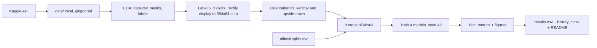
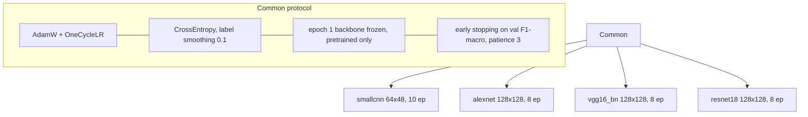

# SPEC (single-prompt SDD) — P2 Computer Vision: Water Meter Digit Reading with CNNs

You are an autonomous engineering agent with NO prior context. This document is the complete specification. Execute it end to end. Do not spawn sub-agents. Save this document verbatim as `docs/SPEC.md` in the repo (step F0): it is also the evidence for the AI-use declaration.

Spec v1.3 · 2026-10-13 · Group **Luminus (Grupo 2)** · course VC001 (Visão Computacional), CESAR School 2026.2.
Changelog: v1.0 draft · v1.1 AI declaration based on spec · v1.2 single-prompt for a no-context agent · v1.3 Mikael's scaffold credited; dataset recon verified (§5.2); orientation algorithm pinned; compute plan (§5.3.1); executable acceptance and review gates (§9.1).

## 0. TL;DR (read first)

1. Work in `~/Developer/hidrometros`, public repo `jhlr/hidrometros`. Save this file as `docs/SPEC.md`.
2. Build crops from `data/WaterMeters` per §5.2 (facts already verified): 1243 valid, 1 discarded, 9944 crops. Never alter `splits.csv`.
3. Fix orientation with the pinned algorithm (minAreaRect → red rule → self-supervised classifier on train only → audit).
4. Smoke-test then train 4 models under one protocol (§5.3, §5.3.1), local MPS, `caffeinate`.
5. Evaluate on test only → `results.csv`, 4 figures, reports. Then the extra (better digit split) in a separate file.
6. README from the professor's template, answers as drafts for the group, AI declaration based on this spec, Mikael credited.
7. `make check` green, pre-push audit green, two human gates (§9.1), then public. No dataset images, crops or checkpoints in git. No attribution lines in commits. Never `rm`.

---

## 1. Goal

Deliver a PUBLIC GitHub repository `jhlr/hidrometros` that solves the professor's assignment: build a digit-classification dataset (10 classes) from the Yandex.Toloka WaterMeters dataset, train `smallcnn`, AlexNet, VGG16-BN and ResNet18 under one identical protocol on the OFFICIAL `splits.csv`, evaluate on the test split, and answer all assignment questions with the group's own numbers. Grading: 10% data acquisition/prep, 25% identical protocol, 30% complete evaluation, 35% critical analysis. Submission is only the repo link; the professor grades the repo state at the deadline.

Language: the assignment, README, answers and docs are in Brazilian Portuguese. Code identifiers, comments and this spec stay in English where natural; user-facing README text in pt-BR.

## 2. Sources (read these first; on conflict they win over this spec)

| Source | Where |
|---|---|
| Assignment statement (authoritative) | `https://github.com/eron93br/vc-20262-p2` : `README.md` (tasks, questions 1.1–5.6, protocol), `README_ENTREGA.md` (README template), `splits.csv` (official split), `requirements.txt`, `.gitignore`. `git clone` it into a scratch dir OUTSIDE the project. |
| Slides summary | `~/Downloads/P2 - Leitura de Hidrômetros com CNNs .pptx.pdf` |
| Project base (teammate's starting point, NOT from the professor) | `~/Downloads/leitura-hidrometros-base.zip`: the initial scaffold written by group member **Mikael de Albuquerque Mulatinho** (contains `src/{models,preprocessing,metrics,reproducibility}.py`, `notebooks/01_inicio.ipynb`, `.gitignore`, `requirements.txt`, a README with a protocol summary). Extract into an empty new dir. It is a draft, not an authority: verify every part against the professor's README (e.g. its protocol summary, `weights="DEFAULT"`, the equal-width `make_digit_crops`) and fix gaps at the cause. Reuse what is correct, and credit Mikael for the scaffold in the README and the AI/authorship declaration (do not present it as AI-generated or as the AI's work; whether Mikael used AI on it is unknown, leave a line for the group to fill). |
| Team members | `~/Downloads/nome-emails.txt` (7 lines `Name - email`; one line has a typo `João Rietra -jhlr@cesar.school`, normalize to `João Rietra (jhlr@cesar.school)`) |
| Dataset | Kaggle `tapakah68/yandextoloka-water-meters-dataset`, license CC BY-NC-ND 4.0 |

Members (put in README as name + email):
Angelita Dias de Santana (ads2@cesar.school) · Carolline de Araújo Mariz (cam3@cesar.school) · Fernando Cyreno Rangel da Silva (fcrs@cesar.school) · Guaraci de Barros Rios (gbr2@cesar.school) · Ivo Caetano Andrade Júnior (icaj@cesar.school) · Mikael de Albuquerque Mulatinho (mam2@cesar.school) · João Rietra (jhlr@cesar.school).

## 3. Authorizations and hard prohibitions

Explicitly authorized by the user (no need to ask again):
- Download the dataset with the Kaggle CLI (`pip install kaggle` in the project venv). Credentials already exist in `~/.kaggle/` (do not print, copy, or commit them).
- Create the PUBLIC repo `jhlr/hidrometros` with `gh` (account `jhlr` is logged in) and push to it.
- Train locally on Apple MPS.

NOT authorized (stop and ask instead): inviting collaborators, posting anywhere else (Classroom, email), changing GitHub account settings, deleting existing repos.

Hard rules:
1. NEVER commit: dataset images, generated crops (`digits/`), checkpoints (`*.pt/*.pth/*.ckpt`), `kaggle.json`/credentials, `data/`. Violating this costs −10%. Sample photos of the dataset are NOT allowed anywhere in git, including notebook outputs.
2. NEVER alter `splits.csv` (must be byte-identical to the professor's; record its sha256).
3. NEVER use models other than the four named (−30%).
4. NEVER `rm`. Move to trash: `mv <path> ~/.Trash/`.
5. Commits: no `Co-Authored-By` or any attribution/trailer lines. Authorship is the user's alone. Use the git identity already configured.
6. Long jobs: wrap with `caffeinate -i`, run in background with logs, poll until finished, and after any killed/finished run check `ps aux` and kill leftover processes you spawned.
7. Warnings are fixed at the cause (migrate deprecated APIs), never suppressed or `# noqa`.
8. Python with full type hints (args, returns, attributes), pyright/mypy-clean, no gratuitous `Any`.
9. Never invent or "estimate" a metric. Every number in README comes from `results.csv` or a logged run. Report negative results as they are.
10. Fix causes, not symptoms. No hacks, no swallowed exceptions.

## 4. Pipeline





## 5. Technical requirements

### 5.1 Repo layout (library, not loose scripts)

```
hidrometros/
  README.md  requirements.txt  splits.csv  results.csv  history_{smallcnn,alexnet,vgg16_bn,resnet18}.csv
  .gitignore  pyproject.toml            # installable editable: pip install -e .
  docs/SPEC.md  docs/<dated notes>.md   # spec + findings, committed
  src/hidrometros/                       # data.py prep.py models.py train.py evaluate.py figures.py report.py cli.py
  tests/                                 # guard tests (pytest)
  notebooks/pratica_watermeters.ipynb    # thin: calls the library, outputs cleared of dataset images
  figures/                               # 4 required PNGs (+ extras ok)
  reports/classification_report_{model}.txt
  # local only, gitignored: data/ digits/ checkpoints/ .venv/
```

Reuse Mikael's starter code (`SmallCNN`, `build_model`, freeze/unfreeze helpers, `set_seed`, `classification_metrics`). Fix its gaps instead of duplicating (e.g. `weights="DEFAULT"` must resolve to IMAGENET1K_V1; AlexNet/VGG LR groups; input size 128×128 for pretrained, 64×48 for smallcnn).

### 5.2 Data (Parts 1–3)

- Inspect the real structure first. Do NOT assume folder or column names: list folders, read `data.csv` columns, open images and masks. Known so far: files such as `WaterMeters/collage/id_1000_value_176_881.jpg` (filename encodes the reading as `value_<int>_<dec>`). Verify download integrity: file counts vs annotations, every image opens.
- Label = 8 digits (5 integer + 3 decimal). Left-pad the integer part to 5; discard images that don't fit the 5+3 format. Required: **1243 valid images, 1 discarded, 9944 crops (1243×8)**. Decide the most reliable label source with evidence (annotation column vs filename vs the visible display) and document it (Question 2.1).
- Rectify the display region (use the annotation masks/polygons) into a **384×64 strip**; split into **8 crops of 48×64**, left to right.
- Detect and fix displays that are vertical or upside-down; report exact counts (Question 3.2). Quantify the kinds of wrong crops the pipeline still produces (e.g. crops straddling two digits, partial digits, rolling-wheel digits).

**Verified recon (done 2026-10-13 on the real download, do not re-derive; re-check only if a number disagrees):**

| Fact | Verified value |
|---|---|
| Download | ~982 MB zip → `data/WaterMeters/{collage,images,masks}/` (1244 files each) + `data.csv` (1244 rows) |
| `data.csv` columns | `photo_name` (str, e.g. `id_53_value_595_825.jpg`), `value` (float, e.g. 595.825), `location` (string-encoded Python dict: `{'type':'polygon','data':[{'x','y'},…]}` with x,y normalized 0–1; parse with `ast.literal_eval`, then multiply by image width/height) |
| Folders | `images/` = full photos (mostly 1000×1333 or 1333×1000, some 1778/2057 wide); `masks/` = grayscale `.jpg` masks of the display region (values 0/1/254/255, JPEG noise); `collage/` = visualization overlay (708 MB), NOT for training |
| Label sources agree | `value` in `data.csv` equals the value parsed from the filename (`id_<id>_value_<int>_<dec>.jpg`) in 1244/1244 rows. `value` is a float: trailing decimal zeros are lost (`21.86` means `21.860`), so decimals MUST be right-padded to 3 and the integer part left-padded to 5: `label = int.zfill(5) + dec.ljust(3,"0")` |
| Valid / discarded | 1243 images give an 8-char label (matches `splits.csv`, 9944 = 1243×8 crops). The 1 discarded is `id_664_value_45_2676.jpg` (4 decimals; it is the only row absent from `splits.csv`). No integer part exceeds 5 digits |
| `splits.csv` | columns `photo_name,split`; 870 train / 186 val / 187 test; sha256 `ca4c5d8ad131d63eae3a8acd5bd6ac1091f55e02426d8ad083af98cfa65abf2b` |
| Digit prior (valid labels) | digit 0 = 35.7% (leading zeros of the integer part), digit 1 = 10.1%, others 5.9–7.8% → class 0 is the majority (Q 2.2) |
| Polygons | 4 points (505 images), 6 points (508), 8 points (231): not always a rectangle. `cv2.minAreaRect` on the pixel polygon gives a good display rectangle (aspect ratio median ≈ 5.0, range 2.8–8.7) |
| Long-axis orientation | by rectangle long axis: 1107 horizontal, 84 vertical, 53 tilted (30–60° or 120–150°) |
| Visual check (local contact sheet, 24 random strips) | rectification works; at least one strip was upside-down (`370_68`); some strips show fewer than 8 full digit cells or half-visible rolling wheels (e.g. `19_0`, `1271_072`), which is the wrong-crop source for Q 3.2/3.3 |
| Decimal wheels | the 3 decimal digits are usually red on a different background than the 5 integer digits (black/dark) |

**Orientation-fix algorithm (pinned; implement exactly, then audit):**
1. Rectify with `cv2.minAreaRect` + perspective warp so the long side is horizontal → 384×64 strip (this already fixes "vertical" and "tilted" displays). Count a strip as rotated if the rectangle long axis was not within 30° of horizontal.
2. 180° ambiguity remains. Seed pseudo-orientation with the red-wheel rule on the strip in HSV (red = `(h<8 or h>170) & s>90 & v>60`): red mass in the right quarter ≥ 2× the left quarter → upright; left ≥ 2× right → upside-down. On the real data this rule gives: upright 842, upside-down 38, ambiguous 31, no red at all 333 (so the rule alone covers only ~71%).
3. For the rest, train a tiny orientation classifier (2 classes: 0° vs 180°) self-supervised: positives = strips judged upright by the red rule, negatives = the same strips rotated 180°. Train ONLY on strips from the `train` split. Use it to decide the remaining 364 strips. Never use val/test images to fit or tune this step, never use the digit labels from test.
4. Audit: view EVERY strip flipped by steps 2–3 and 50 random non-flipped ones (contact sheets, local only, not committed); record the audit result (errors found/corrected) in `docs/<date>-orientation-audit.md` as numbers only. Report in answer 3.2: strips rotated by geometry (count), strips flipped 180° (count by rule 2 and by classifier 3), strips still wrong after audit (count).
5. A manual per-image override file `data_overrides.csv` (photo_name, flip) is allowed ONLY for audit corrections, committed (it contains names, not images).
- Save crops to `digits/{split}/{digit}/{image_id}_{position}.png` and index `digits/index.csv` with columns `image_id, photo_name, position, digit, split, crop_path`. Split strictly by `photo_name` via `splits.csv` (columns `photo_name,split`; 870 train / 186 val / 187 test).
- Visually validate a sample of strips/crops locally (not committed) before training.

### 5.3 Training protocol (Part 4) — identical for all four models

| Model | Weights | Input | Batch CUDA | Batch MPS/CPU | LR head | LR backbone | Max epochs |
|---|---|---|---|---|---|---|---|
| smallcnn | scratch | 64×48 | 256 | 128 | 1e-3 | — | 10 |
| alexnet | IMAGENET1K_V1 | 128×128 | 128 | 64 | 1e-3 | 1e-4 | 8 |
| vgg16_bn | IMAGENET1K_V1 | 128×128 | 32 | 16 | 1e-3 | 1e-5 | 8 |
| resnet18 | IMAGENET1K_V1 | 128×128 | 128 | 64 | 1e-3 | 1e-4 | 8 |

Common: `AdamW` + `OneCycleLR`; `CrossEntropyLoss(label_smoothing=0.1)`; epoch 1 with backbone frozen (pretrained models only; head trained), then unfreeze all; early stopping on val F1-macro, patience 3; `seed=42`; augmentation `RandomAffine(degrees=5, translate=(0.05,0.05), scale=(0.95,1.05))` + `ColorJitter(brightness=0.3, contrast=0.3)`, NO flip; ImageNet mean/std normalization for pretrained models (justify for smallcnn too). Any deviation must apply to all four models and be documented in README.

Use a per-epoch `history_{model}.csv` with columns `epoch, train_loss, train_acc, val_loss, val_acc, val_f1, seconds`. Keep the best checkpoint by val F1-macro under `checkpoints/` (gitignored). Time one epoch of vgg16_bn first; do not shorten epochs unless it applies to all four and is documented.

Tracking: if you use MLflow, a single sqlite `mlflow.db`, no scattered `mlruns/`; it is optional and must not be committed if it contains data.

### 5.3.1 Compute plan (local Apple MPS)

- Smoke test before any full run: for each model, 1 epoch on 256 train crops + 128 val crops, with the real code path (freeze → unfreeze, OneCycleLR, checkpoint save, history row). All four must pass before launching full runs. Report seconds for the smoke test.
- Time one full vgg16_bn epoch first (batch 16, MPS); extrapolate before committing to the full run. Train sequentially (one process on the GPU at a time), order: smallcnn → resnet18 → alexnet → vgg16_bn. Each run is a background `caffeinate -i` process writing a log; poll with sleeps until finished; confirm no leftover processes.
- Resume: save `last.pt` every epoch (gitignored) with model, optimizer, scheduler, epoch, best F1, early-stop counter and RNG state; a rerun with `--resume` continues instead of restarting. `history_*.csv` is appended per epoch, never rewritten.
- `OneCycleLR` is built for the full max-epoch schedule (`epochs × steps_per_epoch`); with early stopping the schedule is simply cut. Document this in the README. Backbone-frozen epoch 1 uses only the head LR group; at unfreeze, the optimizer gets both param groups (head 1e-3, backbone per table); keep the scheduler consistent (build the optimizer with both groups from the start and set backbone requires_grad False in epoch 1).
- Determinism: set seed 42 everywhere (python, numpy, torch, DataLoader generator and worker seeds). MPS is not bit-exact deterministic; state this in the README and do not claim bit-for-bit reproducibility. Runs on CPU/MPS should land within normal run-to-run noise; if you rerun, report that noise.
- `s_per_epoch` = median over the epochs actually run of the pure training-loop wall time (excludes validation and checkpoint save), `torch.mps.synchronize()` before stopping the clock. `ms_per_image` = batch-1, same device for all four models, `model.eval()` + `torch.inference_mode()`, 20 warm-up then 200 timed runs, median, sync after each run. Include the data transform cost? No: tensor already on device; state this.

### 5.4 Evaluation (Part 5) — all metrics on the TEST split only (val only for early stopping)

`results.csv`, one row per model, exactly these columns:
`model, acc_digit, f1_macro, acc_reading, params_M, s_per_epoch, ms_per_image, ckpt_MB, best_epoch`
- `acc_digit`: per-crop accuracy. `f1_macro`: macro F1 over 10 classes. `acc_reading`: fraction of test images with all 8 digits correct.
- `params_M`: parameters in millions. `s_per_epoch`: median training time per epoch excluding validation. `ms_per_image`: batch size 1, median of 200 runs after 20 warm-up runs (sync MPS before timing). `ckpt_MB`: best checkpoint size on disk. `best_epoch`: epoch with the highest val F1-macro.
- `classification_report` per model → `reports/classification_report_{model}.txt`.
- Figures in `figures/`: `confusion_matrices.png` (normalized, 4 models), `accuracy_by_position.png` (positions 0–7), `training_curves.png` (loss and accuracy, train vs val), `performance_vs_cost.png` (F1-macro vs inference ms). Legible, labeled axes, colorblind-safe palette.
- Gallery of the 16 most confident errors per model: notebook only, run locally, then CLEAR those outputs before commit (no dataset images in git).

### 5.5 Extra challenge (optional, +0.5, decided IN: "better digit splitting")

After the 4-model baseline is complete and committed: improve the strip-to-digit division (the equal-width 48 px split cuts digits that straddle cell boundaries; e.g. locate digit boundaries by column intensity/projection or per-digit annotation if available). Retrain with the SAME protocol, report the gain in a separate file `results_extra.csv` and a README section. Never mix it into `results.csv`.

## 6. Questions to answer in README (pt-BR, grounded in your numbers)

1.1 folders/columns of `data.csv`, which folders train a model · 1.2 label per image or per digit, implication · 2.1 most reliable label source + evidence · 2.2 majority digit class and why · 3.1 why split per image not per crop; why everyone uses the same `splits.csv` · 3.2 number of corrected strips and wrong-crop types with counts · 3.3 error from equal-width split, how to fix · 4.1 why ImageNet mean/std · 4.2 parameter counts, where AlexNet/VGG16 parameters concentrate · 4.3 head-only vs full fine-tuning, why freeze only epoch 1 · 4.4 why no flip · 5.1 best F1-macro, same ranking as accuracy? · 5.2 most confused class pairs and why · 5.3 why `acc_reading` ≪ `acc_digit` · 5.4 which model for a mobile app, justify with numbers · 5.5 what ResNet adds over VGG16 here · 5.6 was smallcnn competitive, what it implies.
Mark each answer `<!-- RASCUNHO: grupo reescreve com as próprias palavras -->`. Authorship rule: the group must rewrite them; your drafts are only a base.

## 7. README (fill `README_ENTREGA.md` from the professor, delete its `>` instruction lines)

Must contain: title `Luminus (Grupo 2) — Classificação de Dígitos de Hidrômetros com AlexNet, VGG16 e ResNet`; members (name + email); data source and license; how to reproduce (exact commands from zero, environment, total runtime, split used); training-protocol table with real batch sizes and best epochs; deviations (or "none"); results table GENERATED from `results.csv` by a script (never typed by hand); the 4 figures embedded; the 17 answers; limitations (what the pipeline gets wrong, data vs model attribution, what you'd change); AI-use declaration (7.1).

Visuals: the professor likes mermaid diagrams, schemes and figures. Include in README: the two mermaid diagrams above, a mermaid/ASCII scheme of the strip→8-crop split showing the equal-width error, result figures. NO dataset photos or crops (license + −10%). Use drawn schemes or synthetic digit mock-ups only.

### 7.1 AI-use declaration (SDD)

Based on this spec: (1) declare Spec-Driven Development, spec written and approved before code and committed at `docs/SPEC.md`; (2) table phase → what the AI did → what the group decided/verified; (3) human decisions D1–D7 below; (4) traceability criterion → test → commit; (5) answers/limitations rewritten by the group, AI gave drafts from `results.csv`; (6) link to the spec; (7) provenance: initial scaffold by Mikael de Albuquerque Mulatinho (human, group member), later extended and corrected under this spec; keep Mikael's commits/authorship if he is added to history, and do not rewrite his scaffold as AI output. Add a spec changelog entry for every deviation you make. Leave a clearly marked stub so the group can paste the equivalent text into the Classroom template (not accessible to you).

Locked human decisions: D1 local MPS training with MPS/CPU batch sizes · D2 library in `src/` + thin notebook · D3 no dataset photos in git · D4 answers as drafts, group rewrites · D5 extra challenge = better digit splitting, separate results file · D6 public repo, no collaborator · D7 members from `nome-emails.txt`.

## 8. Phases and exit gates (do in order; commit after each gate; push at the end of each phase from F1)

| Phase | Output | Exit gate |
|---|---|---|
| F0 | work dir `~/Developer/hidrometros` (NOT a scratch/temp dir), `git init`, venv, `.gitignore`, `docs/SPEC.md` | `git status` clean of data; `torch.backends.mps.is_available()` true |
| F1 | dataset in `data/` | counts match annotations; all images open; splits.csv sha256 equals upstream |
| F2 | EDA notebook cells + findings in `docs/<date>-eda.md` | evidence for 1.1, 1.2, 2.1, 2.2 |
| F3 | `digits/`, `digits/index.csv`, prep CLI | 1243 valid, 1 discarded, 9944 crops, 0 image in >1 split, corrected-strip count |
| F4 | 4× `history_*.csv`, local checkpoints | same splits/seed/protocol, hyperparameters match §5.3 |
| F5 | `results.csv`, reports, 4 figures | test-only metrics, all 9 columns, 4 rows |
| F6 | extra: improved splitting + `results_extra.csv` | same protocol, gain measured honestly (may be zero or negative: report it) |
| F7 | README + answers + AI declaration | README table == `results.csv` (automated) |
| F8 | public repo `jhlr/hidrometros` | all acceptance criteria pass; repo opens logged out |

If the gate for a phase fails, fix the cause before moving on. If blocked on something outside this spec (e.g. dataset structure contradicts §5.2), update the spec changelog, make the most reversible choice, and note it in the final report.

## 9. Acceptance criteria (all must pass; automate what you can in `tests/`)

1. `splits.csv` sha256 equals the professor's.
2. 1243 valid, 1 discarded, 9944 crops; `digits/index.csv` has the 6 required columns.
3. No `photo_name` appears in more than one split (test).
4. Corrected-strip count and wrong-crop types with counts reported in answer 3.2.
5. 4 models trained exactly per §5.3; seed 42; no flip.
6. `history_*.csv` have the 7 required columns.
7. `results.csv`: 4 rows × 9 columns, test split only (test).
8. The 4 figures exist, are legible, and are embedded in README.
9. `classification_report` saved per model.
10. Notebook committed with dataset images cleared from outputs (test scans notebook JSON for embedded images).
11. README complete (members, reproduction, protocol, results == `results.csv`, 17 answers, limitations, AI declaration with link to `docs/SPEC.md`).
12. `git ls-files` contains no dataset image, `digits/`, checkpoint, credential or `data/` file (test).
13. Repo is public and loads logged out.
14. Guard tests for 1, 3, 7, 10, 11, 12 were seen RED before GREEN: write the test before the fix, or prove red with `git stash`; log how many cases failed.

### 9.1 Executable acceptance and review gates

- Provide `make check` (or `python -m hidrometros.check`) that prints one PASS/FAIL line per criterion 1–13 and exits non-zero on any FAIL. Criterion 14 is a log in `docs/<date>-guard-red.md` (test name, cases failed before the fix, command used, e.g. `git stash`). Each criterion is written as Given/When/Then in the test docstring.
- Pre-push audit (run before the FIRST push and every push): `git ls-files` must contain none of: `*.jpg/*.jpeg/*.png` outside `figures/` and `docs/`, `digits/`, `data/`, `*.pt/*.pth/*.ckpt`, `kaggle*.json`, `credentials*`; every `figures/*.png` must be a plot (no dataset photo); notebook JSON has no `image/png` or `image/jpeg` outputs. If anything fails, do not push.
- Human review gates (stop and report, then continue only if the user replies; if no reply is possible, continue and flag it in the final report):
  1. After F3: numbers only (valid/discarded/crops, rotated and flipped counts, audit result, per-split crop counts, digit distribution) plus the path of a local contact sheet for the user to eyeball.
  2. Before making the repo public: output of the pre-push audit and the README/`results.csv` equality check.
- The repo may be created private first and flipped to public after gate 2 (`gh repo edit jhlr/hidrometros --visibility public --accept-visibility-change-consequences`); final state must be public (criterion 13).

## 10. Risks

| Risk | Impact | Mitigation |
|---|---|---|
| README ≠ results.csv | −20% | README table generated by script + test |
| Split leakage | zeroes the 25% protocol item | split only by `photo_name` from official `splits.csv`; test 3 |
| Dataset images in git/notebook | −10% | `.gitignore`, clear outputs, test 10 and 12 |
| VGG16-BN slow on MPS | schedule | time one epoch first; any shortening applies to all four and is documented |
| MPS numerical/timing quirks | wrong `ms_per_image` | `torch.mps.synchronize()` around timing; same device for all models |
| Missing AI declaration | −20% | §7.1 + stub for Classroom |
| Orientation/crop errors | accuracy, 3.2/3.3 | quantify; extra challenge addresses splitting |

## 11. Final report (your last message, short)

State: repo URL; the 4-row results table copied from `results.csv`; acceptance criteria pass/fail list; deviations from the spec; anything the user must still do (paste AI declaration into Classroom, rewrite answers in own words, submit link, deadline unknown). No attribution lines anywhere. Say plainly what was skipped or failed.
